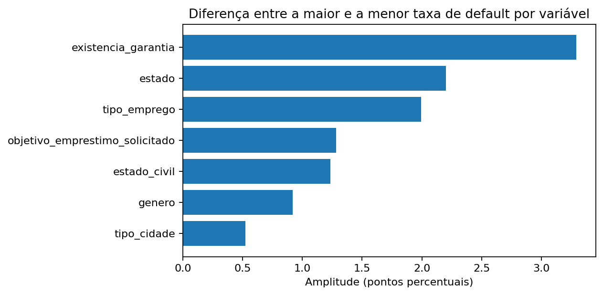
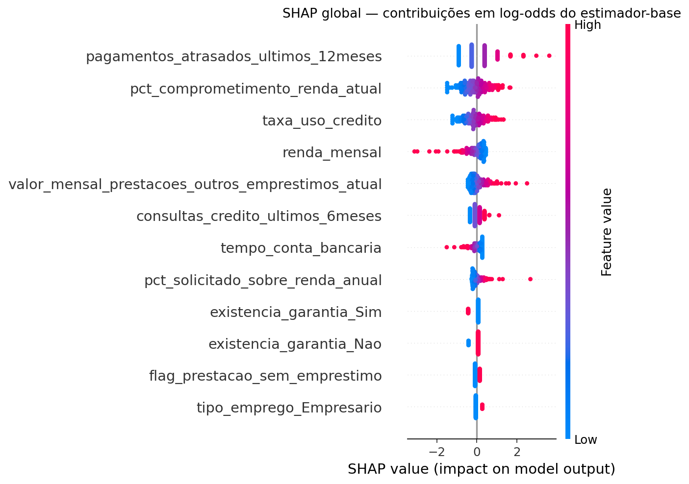

# 📊 Pipeline de Modelagem e Monitoração de Risco de Crédito

Este repositório contém uma solução completa de ponta a ponta para a estimativa de Probabilidade de Default (PD) e monitoração contínua de modelos de crédito. O projeto foi desenvolvido como produção temática para o **PSI 15520 (GN Monitoração e Validação de Modelos)**.

## 🎯 Resumo dos Resultados
* **Modelo Escolhido:** Regressão Logística (Calibrada via método Sigmoid).
* **Performance (Teste):** ROC-AUC: `0.8587` | Gini: `0.7173` | KS: `0.5766`
* **Explicabilidade:** Implementada via SHAP (visão global e local).
* **Monitoração (O Vigia):** Implementação de PSI/CSI para detecção de *Data Drift*, validada através de simulação de crise econômica.

---

## 🚀 Como Executar

O projeto foi construído em um Jupyter Notebook modular. Para rodar:
1. Clone o repositório.
2. Coloque o arquivo `dados_credito.csv` na raiz do projeto.
3. Execute o notebook `pipeline_risco_credito_v3.ipynb` clicando em **Run All**.
4. O código criará automaticamente as pastas `artifacts/` (modelos e metadados) e `reports/` (tabelas e gráficos).

---

## 🛠️ O Pipeline Passo a Passo

O fluxo analítico foi dividido em 6 etapas estruturadas, garantindo governança, ausência de vazamento de dados (*data leakage*) e reprodutibilidade.

### Etapa 0 — Configuração
Configuração do ambiente, definição da semente aleatória (`SEED = 42`) para garantir resultados reproduzíveis e criação automática da estrutura de diretórios do projeto.

### Etapa 1 — Ingestão e Validação
O pipeline lê a base de **25.000 registros e 19 colunas**.
* Os nomes das colunas são normalizados.
* É feita a verificação rígida do contrato de dados (colunas esperadas e ausência de duplicidades no ID).
* A taxa de inadimplência (default) detectada na base inteira é de **6,14%** (base altamente desbalanceada).

### Etapa 2 — Análise Exploratória e Diagnóstico
O diagnóstico revelou que as variáveis mais associadas ao default são o **histórico de atrasos** e o **uso do limite de crédito**. Foram aplicadas 12 regras de qualidade. Inconsistências não geraram exclusão de linhas, mas sim *flags* sinalizadoras para o modelo aprender.

*Figura: Distribuição do alvo, default por atrasos e uso de crédito, e matriz de correlação.*

### Etapa 3 — Preparação e Pré-processamento
A base foi dividida em **Treino (75%)** e **Teste Reservado (25%)**.
* **Engenharia de Variáveis (Feature Engineering):** Foram criadas variáveis de negócio, como o *comprometimento atual da renda* e o *DTI (Debt-to-Income) estimado*.
* **Tratamento:** Imputação com a mediana para numéricos e *One-Hot Encoding* para categóricos, encapsulados em um `Pipeline` do Scikit-Learn.

### Etapa 4 — Modelagem, Avaliação e Explicabilidade
Foi adotada a estratégia **Challenger vs Baseline**:
* **Candidatos:** Regressão Logística (Baseline interpretável) vs LightGBM (Challenger não-linear).
* **Seleção:** A Regressão Logística obteve a melhor métrica ROC-AUC na validação interna e foi selecionada.
* **Calibração:** As probabilidades foram corrigidas (Platt Scaling) para refletir o risco real da carteira.

*Figura: ROC-AUC no teste, Curva de Calibração e Ordenação de Risco por Decis (D10 = Maior Risco).*

**Transparência (SHAP):**
A explicabilidade garante que o modelo não seja uma caixa-preta. Os atrasos e o comprometimento da renda foram os fatores que mais impulsionaram o risco. O gráfico *Waterfall* ilustra a justificativa de risco para o pior cliente da base.

  
  

### Etapa 5 — Monitoração de Estabilidade (O Vigia)
Como a base não possui datas (safras temporais reais), criamos um **simulador de crise econômica** para provar que a monitoração funciona:
1. **Safra Estável:** Amostragem normal. PSI manteve-se em **0.0008 (VERDE)**.
2. **Safra em Crise:** Aumentamos os atrasos de 60% dos clientes e reduzimos a renda de 40%. O PSI disparou para **0.3334 (VERMELHO)**, acionando o alarme de revisão do modelo.

*Figura: Deslocamento da distribuição do score na crise (Data Drift) e variáveis que mais sofreram alteração (CSI).*

### Etapa 6 — Persistência e Artefatos
Todos os achados, o modelo treinado e as bases de *scores* são automaticamente salvos.
* O modelo fica em `artifacts/modelo_final_calibrado.joblib`.
* As regras de engenharia ficam em `feature_engineering_psi15520.py`.
* Metadados (ambiente, versões, parâmetros) são salvos em `.json` para rápida auditoria.

---

## ⚠️ Limitações e Estratégias de Superação
* **Falta de Série Temporal:** Superada com a injeção artificial de uma crise econômica, permitindo homologar o sistema de monitoração (PSI/CSI).
* **Dicionário de Dados Ausente:** Premissas (ex: tempo de conta em anos, taxa de uso em %) foram parametrizadas de forma clara no código, facilitando ajustes futuros pelo time de negócios.
