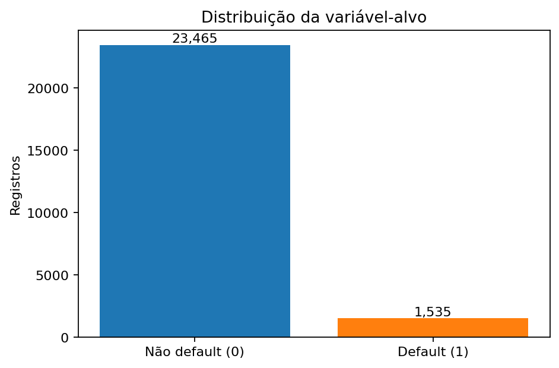
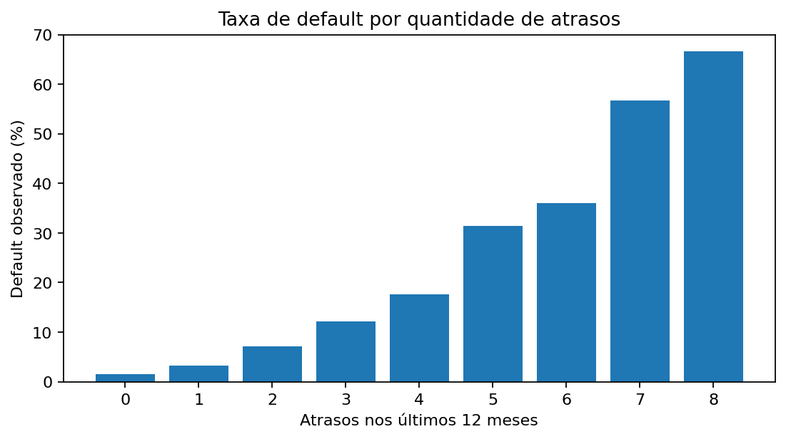
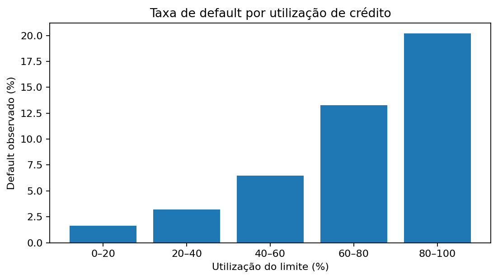
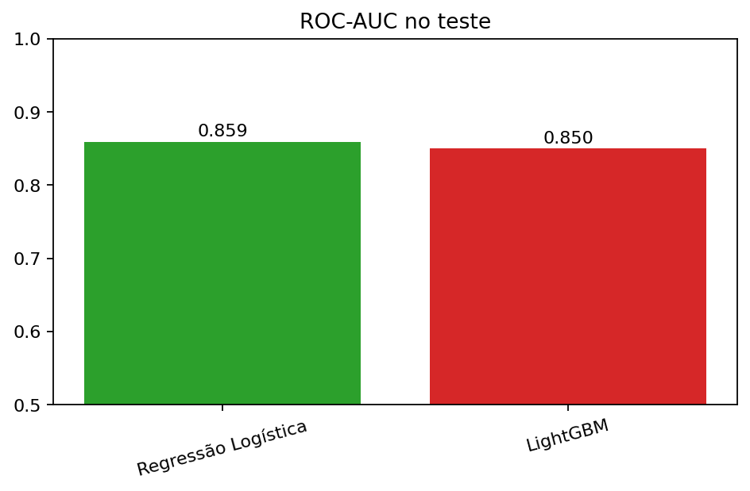
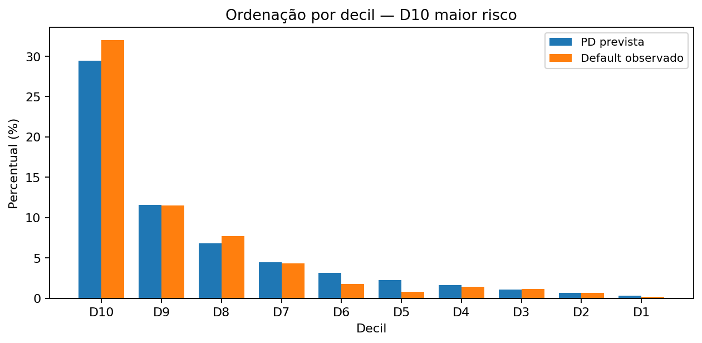
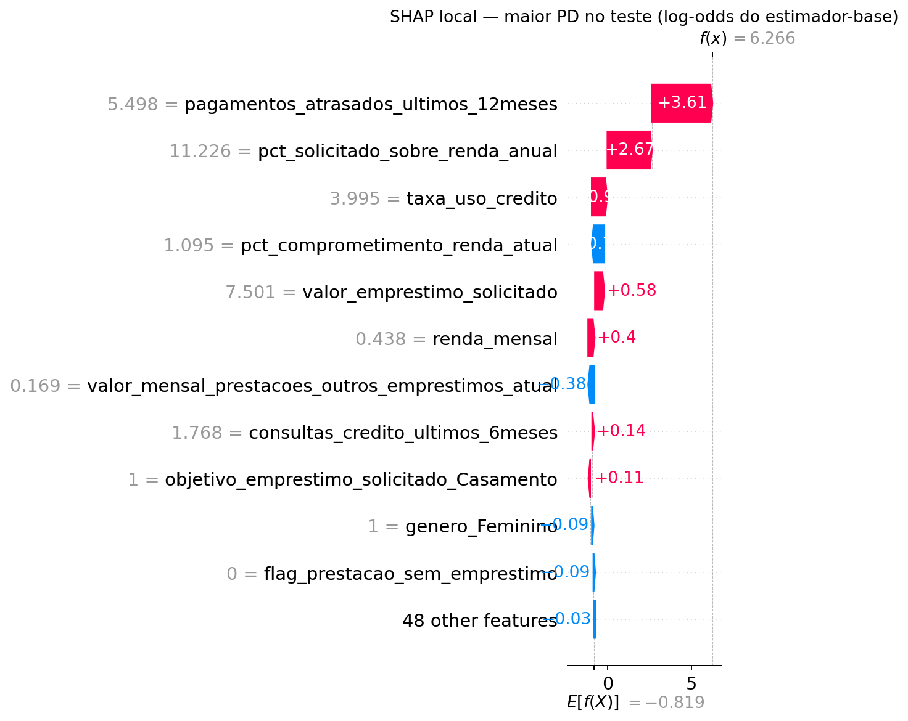
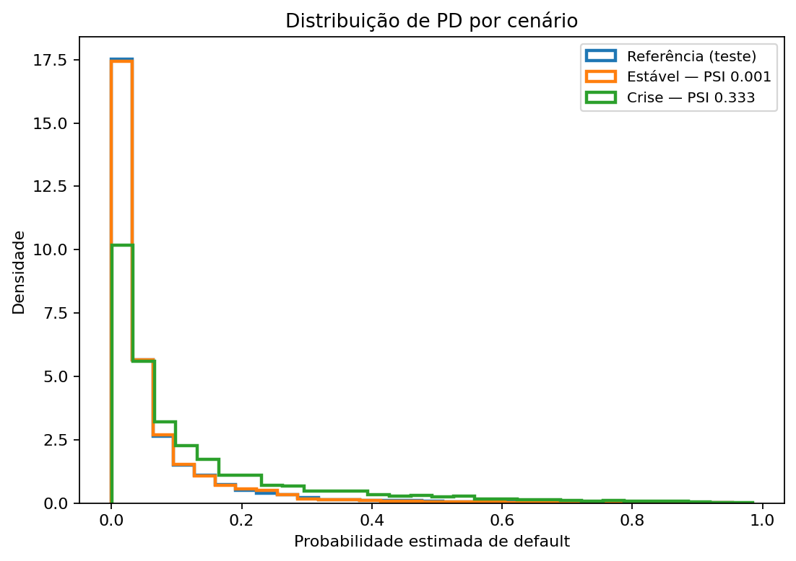
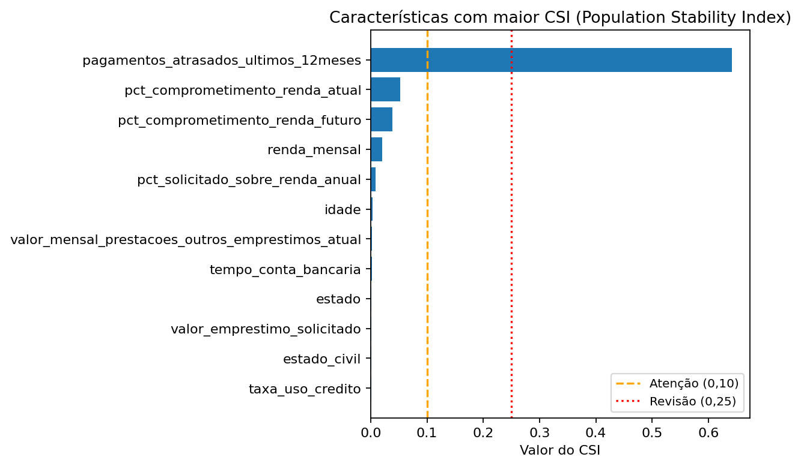

# 📊 Modelagem e Monitoração de Risco de Crédito (PD)

Este repositório contém um fluxo analítico ponta a ponta (Pipeline) para estimar a **Probabilidade de Default (PD)** de clientes e realizar a **monitoração contínua do modelo**. Projeto desenvolvido para a área de Validação de Modelos (PSI 15520).

## 🏆 Resultados Principais
- **Modelo Final:** Regressão Logística (Calibrada com método *Sigmoid*).
- **Performance (Teste):** ROC-AUC: `0.8587` | Gini: `0.7173` | KS: `0.5766`
- **Monitoração (PSI/CSI):** Implementada com sucesso. O alarme disparou corretamente (PSI = `0.3334`) durante a simulação de uma crise econômica.

---

## 🛠️ Estrutura do Pipeline (Passo a Passo)

O projeto foi organizado em um Jupyter Notebook modular, dividido nas seguintes etapas para garantir governança e reprodutibilidade:

### Etapa 0 — Configuração
Configuração de ambiente, definição de pastas de saída (`/artifacts` e `/reports`) e fixação de semente aleatória (`SEED = 42`) para garantir resultados 100% reproduzíveis.

### Etapa 1 — Ingestão e Validação dos Dados
O pipeline lê uma base de **25.000 registros e 19 colunas**. É feita uma validação rigorosa para garantir que não faltam colunas obrigatórias e que não há IDs duplicados.
- **Taxa de Inadimplência:** A base é altamente desbalanceada, com apenas **6,14%** de default.

  

### Etapa 2 — Análise Exploratória e Diagnóstico
Avaliação do comportamento das variáveis e diagnóstico de 12 regras de negócio. Inconsistências (como "parcela a pagar sem empréstimo ativo") não foram excluídas, mas transformadas em *flags* (sinalizadores) para o modelo aprender.
- O histórico de atrasos e o uso do limite de crédito mostraram ser os maiores indicadores de risco.

  
  

### Etapa 3 — Preparação e Pré-processamento
Para evitar o vazamento de dados (*data leakage*), a base foi dividida em **Treino (75%)** e **Teste (25%)** antes de qualquer cálculo.
- **Feature Engineering:** Foram criadas novas variáveis, com destaque para o *Comprometimento da Renda* (atual e futuro).
- **Pipeline:** Imputação pela mediana e *One-Hot Encoding* encapsulados para aplicação segura em produção.

### Etapa 4 — Modelagem, Avaliação e Explicabilidade
Abordagem *Baseline* (Regressão Logística) vs *Challenger* (LightGBM). A Regressão Logística venceu na capacidade de separar bons de maus pagadores e foi calibrada para emitir probabilidades realistas.

  
  

**Explicabilidade (Caixa-Branca):**
Utilizamos a biblioteca **SHAP** para entender o modelo. Globalmente, atrasos importam mais. Localmente, o gráfico *Waterfall* explica passo a passo a nota do pior cliente da base, facilitando a transparência regulatória.

  
  

### Etapa 5 — Monitoramento da Estabilidade ("O Vigia")
Como a base é estática, desenvolvemos um **simulador de crise** para testar os alertas.
1. **Safra Estável:** O modelo mediu a diferença entre hoje e o passado. **PSI = 0.0008 (VERDE)**.
2. **Safra em Crise:** Aumentamos artificialmente os atrasos e derrubamos a renda. O alarme reagiu imediatamente: **PSI = 0.3334 (VERMELHO - Alerta Crítico)**.

  
  

### Etapa 6 — Salvamento dos Artefatos
O modelo validado é salvo em formato `.joblib`, a base recebe a pontuação (scoring) e um arquivo `metadados_modelo.json` registra todo o ambiente (versões, hiperparâmetros, regras) para auditoria.

---

## ⚠️ Limitações e Estratégias de Superação
* **Falta de Série Temporal:** Superada com a injeção artificial de uma crise econômica, permitindo homologar o sistema de monitoração (PSI/CSI).
* **Dicionário de Dados Ausente:** Premissas (ex: tempo de conta em anos, taxa de uso em %) foram parametrizadas de forma clara no código, facilitando ajustes futuros pelo time de negócios.
